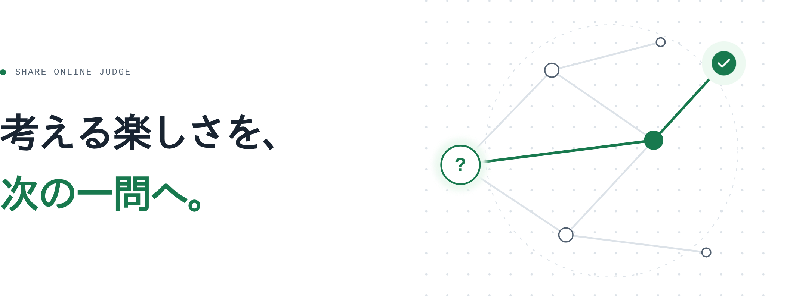
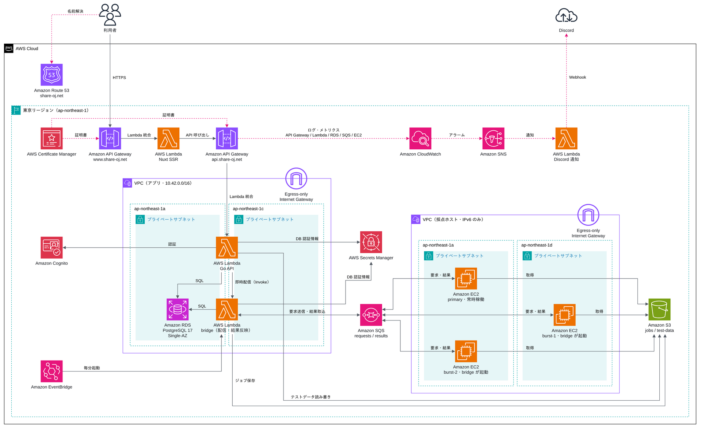

<p align="center">
  <a href="https://www.share-oj.net/">
    <picture>
      <source media="(prefers-color-scheme: dark)" srcset="docs/readme/hero-dark.png">
      
    </picture>
  </a>
</p>

<h1 align="center">ShareOJ</h1>

<p align="center">
  プログラミング問題を解き、作り、共有できるオンラインジャッジ
</p>

<p align="center">
  <a href="https://www.share-oj.net/"></a>
  <a href="https://github.com/loop0919/shareoj/actions/workflows/ci.yml"></a>
  <a href="https://github.com/loop0919/shareoj/releases"></a>
  <a href="https://github.com/loop0919/shareoj/issues"></a>
</p>

<p align="center">
  <a href="https://www.share-oj.net/"><b>ShareOJを使う</b></a> ·
  <a href="https://www.share-oj.net/problems">問題</a> ·
  <a href="https://www.share-oj.net/contests">コンテスト</a> ·
  <a href="https://www.share-oj.net/blog">記事</a> ·
  <a href="https://www.share-oj.net/docs">ガイド</a>
</p>

ShareOJ（Share Online Judge）は、コードを提出して自動採点を受けるだけでなく、自作の問題や、解き方から学んだことを公開できるオンラインジャッジです。

## ShareOJでできること

| できること | 内容 |
| --- | --- |
| [問題を解く](https://www.share-oj.net/problems) | 公開されている問題に挑戦し、コードを提出して採点結果を確認できます。 |
| [問題を作る](https://www.share-oj.net/problems/new) | 問題文とテストケースを用意して、自作の問題を公開できます。スペシャルジャッジやインタラクティブ問題も作れます。 |
| [記事を書く](https://www.share-oj.net/blog) | 問題の解き方や学んだことを記事にして、ほかの人と共有できます。 |
| [コンテストを楽しむ](https://www.share-oj.net/contests) | コンテストに参加するほか、自分で開催することもできます。 |
| [定期便を解く](https://www.share-oj.net/docs/featured) | 毎週月曜と木曜の22:00 (JST)に、EasyとHardを1問ずつ出題します。 |

提出には、C++、Python、Rust、Go、Java、C#、Haskell、TypeScript、Rubyなど30以上の言語を使えます（[言語とバージョンの一覧](https://www.share-oj.net/docs/languages)）。

## はじめるには

- **解く**：[公開問題](https://www.share-oj.net/problems)から、気になる一問を探してみてください。
- **登録する**：アカウントは[新規登録](https://www.share-oj.net/signup)から作成できます。
- **作る**：作問から始めたい方は、[問題作成](https://www.share-oj.net/problems/new)へどうぞ。

ローカルで問題文や生成コードを編集してアップロードする場合は、[Go 製の作問 CLI](cli/README.md)を利用できます。

```sh
curl -fsSL https://www.share-oj.net/install.sh | bash
```

## しくみ

<p align="center">
  <a href="docs/infrastructure/README.md"></a>
</p>

1. 提出をGo API（Lambda）が受け付け、bridge（Lambda）がジョブをS3に保存してSQSへ送ります。
2. EC2の採点ワーカーがジョブを受け取り、isolateで隔離してコンパイルと実行を行います。
3. 結果はSQSを通って戻り、bridgeがPostgreSQLへ反映します。

| 領域 | 技術 | ディレクトリ |
| --- | --- | --- |
| フロントエンド | Nuxt 4、Bun、AWS Lambda | [web/](web/) |
| API | Go、AWS Lambda、PostgreSQL 17 | [api/](api/) |
| ジャッジ | Python、isolate、EC2、SQS、S3 | [judge/](judge/) |
| 作問CLI | Go | [cli/](cli/) |
| インフラ | Terraform、Nix | [infra/](infra/) |

くわしくは[ジャッジの実行モデル](docs/judge/execution-model.md)、[インフラ構成](docs/infrastructure/README.md)、[Architecture Decision Records](docs/adr/README.md)をご覧ください。

## バグ報告・機能提案

バグ報告・機能提案は[Issue](https://github.com/loop0919/shareoj/issues)へお願いします。
現在、外部からのPull Requestは受け付けていません。

## ライセンス

[All rights reserved](LICENSE.md)

## 開発環境

このリポジトリでは、ShareOJのGo API、Nuxtフロントエンド、AWS上のジャッジ基盤を開発しています。

<details>
<summary>ローカル環境の起動と開発手順</summary>

Nix と make をインストール済みなら、リポジトリのルートで次のコマンドを実行する。

```console
make dev
```

Nix 開発環境を読み込み、フロントエンドの依存関係のインストール、Go API のビルド、ローカルPostgreSQLの準備、APIとNuxtの起動を行う。
依存関係は初回と `web/package.json`、`web/bun.lock`、Bun のバージョンが変わったときにインストールする。
初回はツールと依存関係のダウンロードに時間がかかる。

- ホーム: <http://localhost:3000/>
- 公開問題: <http://localhost:3000/problems>
- ブログ: <http://localhost:3000/blog>
- 問題作成: <http://localhost:3000/problems/new>
- API ヘルスチェック: <http://localhost:8080/health>

Ctrl+C で両サーバーを停止する。
片方のサーバーが終了した場合も、もう片方を停止する。
Nuxt は変更を自動反映する。Go の変更は Ctrl+C の後に `make dev` で再起動する。
公開問題の閲覧にはAWSの認証情報を必要としない。
`DATABASE_URL`が空なら、開発用PostgreSQLを127.0.0.1:15432で起動し、スキーマを自動適用する。
データは`.local/postgres`へ保存され、APIを再起動しても残る。
DBはCtrl+Cで停止しないため、停止する場合は`make db-down`を実行する。
ログイン API を利用する場合は、ルートの `.env` に `AWS_REGION`、`COGNITO_USER_POOL_ID`、`COGNITO_CLIENT_ID`と、必要なら`COGNITO_CLIENT_SECRET`を記入する（[API の設定](api/README.md#ログインapi)）。
`/signup`で新規登録してメールの確認コードを入力し、`/login`からログインする。
ログインすると、問題をアカウントへ保存し、`/my?tab=problems`から再編集できる。
既存のCognitoでは、セルフサインアップを有効にするTerraform変更の適用が必要になる。
`make dev` はルートの `.env` を読み込み、同名のシェル環境変数があればそちらを優先する。

ポートが使用中の場合は、停止してから起動するか、次のように変更する。
Nuxt の API 接続先と公開 URL も指定したポートに合わせて設定する。

```console
API_PORT=18080 WEB_PORT=13000 make dev
```

### 開発ツールのみを利用する場合

ルートの`flake.nix`と`flake.lock`で、API、フロントエンド、infraに共通する開発ツールを管理する。
Go、gopls、gofumpt、golangci-lint、Bun 1.4.4、PostgreSQL 17、AWS CLI、Terraform、zipを利用できる。
フロントエンドはNode.jsを使わない（[ADR 0035](docs/adr/0035-run-frontend-on-bun.md)）。

リポジトリのルートで開発シェルを起動する。

```console
nix develop .
```

direnvとnix-direnvを設定済みの場合は、初回にルートで許可する。
以後は`api/`や`infra/bootstrap/`への移動でも同じ環境を使う。

```console
direnv allow
```

Terraformのバージョンとbootstrapの構成を確認する例：

```console
terraform version
terraform -chdir=infra/bootstrap init
terraform -chdir=infra/bootstrap plan
```

## AWSプロファイル

ルートの`.env`で、AWS CLIとTerraformが使うプロファイルを指定する。
初回は設定例をコピーし、自分のプロファイル名に変更する。

```console
cp -n .env.example .env
```

```dotenv
AWS_PROFILE=loop0919
```

`.envrc`が[direnvの`dotenv_if_exists`](https://direnv.net/man/direnv-stdlib.1.html)で読み込むため、`.env`がなくても開発シェルは利用できる。
`.env`はGitの管理対象から除外している。
AWSの認証情報は既存のAWSプロファイルで管理する。

`.envrc`の変更後はルートで再度許可し、接続先を確認する。

```console
direnv allow
aws configure list
aws sts get-caller-identity
```

`nix develop`単体では`.env`を読み込まない。
direnvを使わない場合は、開発シェル内でルートの`.env`を読み込む。

```console
set -a
. ./.env
set +a
```

## 開発手順

`git push`時の自動テストは行わない。
変更に応じて以下の手順でローカル検証を行い、CIで型チェック・ビルド・ブラウザーテスト・実DB連携テストを実行する。

- [APIの起動とテスト](api/README.md)
- [フロントエンドの起動とSSRの確認](web/README.md)
- [AWSインフラの作成とデプロイ](infra/README.md)
- [設計文書](docs/README.md)
- [ローカルでC++を提出する](docs/judge/local-cpp.md)

依存パッケージの既知の脆弱性は[Vulnerabilities](.github/workflows/vulnerabilities.yml)ワークフローで調べる。
mainへのpush、プルリクエスト、毎日6時17分（日本時間）に実行する。
修正版のない脆弱性でデプロイを止めないよう、CIとは別にしている。
Goは`api`と`cli`を、ビルドと同じGoのバージョンで`govulncheck`にかけ、コードから呼ばれる脆弱性があれば失敗する。
npmパッケージは`web`の本番依存を`bun audit`（npmレジストリの勧告）で調べ、highとcriticalがあれば失敗する。
修正版がないものや本番のLambdaバンドルに含まれないものは、理由と見直し日を付けて[web/npm-audit-allowlist.json](web/npm-audit-allowlist.json)に載せる。
見直し日を過ぎると再び失敗する。
`judge/runtime/deps/go`と`judge/runtime/deps/additions`は提出コードに提供するライブラリで、提出コードは元から任意のコードとして隔離して実行するため対象外とする。

AWSアカウント全体の設定（請求アラート、リージョン制限、GuardDuty、IAM Access Analyzer、CloudTrailのtrail）は、このリポジトリの管理対象外である。
別フォルダ`~/aws-setting`で管理し、このリポジトリのCI/CDではデプロイしない。

</details>
