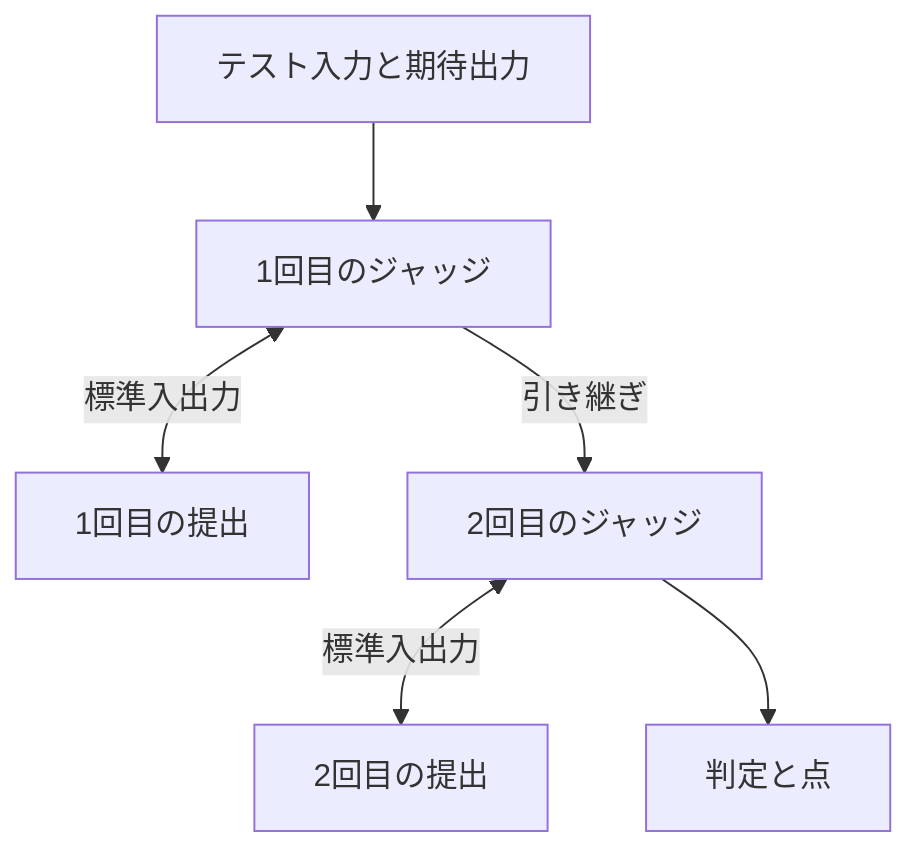

# 2ステップ形式（Run-twice）

[ADR 0036](../adr/0036-support-run-twice-judge.md)に従い、提出を1ケースにつき2回実行し、作問者の2ステップ用ジャッジが1回目の結果を2回目へ引き継ぐ。
各回の実行と判定には、[インタラクティブ問題](interactive-judge.md)の1ケースと同じ規則を使う。
実機での検証は、まだ行っていない。
開発用Dockerワーカーは2ステップ形式の提出を受け付けない。

## 作問と保存

問題編集画面の判定方法で「2ステップ形式（Run-twice）」を選び、2ステップ用ジャッジの言語、形式（現行、testlib）、コードを登録する。
下書きには`runTwice: {"runtime": "python314", "source": "...", "protocol": "legacy"}`を保存する。
`checker`、`interactor`、`runTwice`は、同時に2つ以上を指定できない。
すべてなければ通常判定とし、生成用と入力検証用のジョブには`runTwice`を指定しない。
testlib形式を選べるのは、言語がC++23（GCCかClang）のときだけである。

言語の選び方、空コードの扱い、公開と提出の受付時の固定は、対話用ジャッジと同じ規則で扱う。
公開準備の指摘には`run_twice_source_missing`と`run_twice_runtime_unavailable`を使う。
リジャッジ、サンプル検証（`easyTest`）、部分点（グループ方式と集計コード方式）は、対話形式と同じく使える。
問題の公開APIはコードを返さず、`runTwice: true`だけを返す。
問題ページとコンテストの問題ページには、2ステップ形式であることとflushの注意を表示する。

CLIでは、`problem.toml`の`[run_twice]`に`source`と`runtime`を書く。
`pull`は2ステップ用ジャッジのコードを`run_twice.txt`に保存する。
`[checker]`、`[interactor]`、`[run_twice]`は2つ以上を同時に指定できず、`push`は指定した1つ以外の判定コードをリモートの下書きから消す。

## 1ケースの実行

提出と2ステップ用ジャッジは、提出ごとにそれぞれ1回だけコンパイルする。
各回は対話形式の1ケースと同じく、2つの隔離環境を作り、両方のプログラムを同時に起動して標準入出力を中継し、終了後に作業領域と子孫プロセスを破棄する。
2回目の隔離環境は新しく作り、1回目の内容を残さない。
残すのは、管理ワーカーが読み取った引き継ぎの内容だけである。
提出が1回目に書いたファイルは、2回目の隔離環境にはない。

### 現行形式の引数

対話用ジャッジの4つの引数の後ろに、2つを足す。

1. テスト入力。
2. 期待出力。未使用なら空ファイル。
3. 提出されたソースコード。
4. 書き込み可能なスコアファイル。集計コード方式の問題とそのサンプル検証でだけ、2回目に書いた内容を読む。
5. 何回目か。`1`か`2`の文字列。
6. 引き継ぎファイル。

引き継ぎファイルは、1回目には空で書き込める。
2回目には1回目に書いた内容が入っていて、読み取り専用である。
テスト入力と期待出力は、2回とも同じものを渡す。

### testlib形式の引数

引数は対話形式と同じく`inf`、`tout`、`ans`の順とし、集計コード方式の問題では結果ファイルと`-appes`を足す。
testlibの`registerInteraction`は余分な引数を受け付けないので、引き継ぎは`tout`と`inf`で行う。

- 1回目の`inf`はテスト入力である。
  `tout`に書いた内容が引き継ぎになる。
- 2回目の`inf`は、1回目の`tout`の内容である。
  元のテスト入力は渡らない。
  2回目の`tout`は使わない。
- `ans`は2回とも期待出力である。
- 何回目かは引数で伝わらない。
  作問者はテスト入力の先頭に`1`を置き、`tout`の先頭に`2`を書くなどして見分ける。

### 引き継ぎ

- 上限は16 MiB（16,777,216バイト）とする。
  超えた場合と、通常のファイルでない場合（リンク、FIFO、ジャッジが消した場合など）は、提出全体をJEにする。
- 空でもよい。
  testlib形式では、2回目の`inf`が空になる。
- 1回目の両方のプログラムが止まってから読む。
  読むのは1回目がACのときだけとし、大きさもそのときにだけ確かめる。
- 提出の隔離環境には置かない。

## 判定

各回の判定は、[対話形式の終了と判定](interactive-judge.md#終了と判定)の規則で決める。

- 1回目がAC以外なら、それをケースの判定とし、2回目を実行しない。
  JEなら、既存の規則どおり提出全体をJEにする。
- 1回目がACなら2回目を実行し、その判定をケースの判定とする。
- どちらの回でも、ACには提出の正常終了が必要である。

点は2回目だけから読む。
1回目のスコアファイルと結果ファイルからは点を読まない。
testlib形式の1回目が`quitp`で終えた場合は、集計コード方式の問題とそのサンプル検証でだけ、`_ok`と同じく通過として扱い、点を捨てる。
それ以外の問題では、既存の対話形式と同じくJEとし、診断に既存の注記を残す。

ケースの計測値は次のとおりとする。

| 項目 | 値 |
| --- | --- |
| CPU時間 | 2回のうち大きいほう |
| 最大メモリ | 2回のうち大きいほう |
| 経過時間 | 2回の合計 |

2回目を実行しなかったケースは、1回目の値を使う。

部分点のTLEによる打ち切りは、ケースの最終的な判定で数える。
どちらの回のTLEでも、ケースとしては1回のTLEである。

## 資源上限

各回の上限は、対話形式の値をそのまま使う。

| 対象 | 上限 |
| --- | --- |
| 提出のCPU時間 | 問題設定の100〜5,000 ms。1回ごと |
| 提出の実行メモリ | 問題設定の64〜512 MiB。1回ごと |
| 2ステップ用ジャッジのCPU時間 | 1回ごとに5秒 |
| 2ステップ用ジャッジの実行メモリ | 1回ごとに256 MiB |
| 対話の経過時間 | 1回ごとに`3 × (提出のCPU上限秒 + 5) + 1`秒 |
| 各方向の標準出力 | 1回ごとに16 MiB |
| 各プログラムの標準エラー | 1回ごとに64 KiB |
| 引き継ぎ | 16 MiB |
| ソース | 提出128 KiB、2ステップ用ジャッジ64 KiB。NUL不可 |
| 採点全体の経過時間 | コンパイルと全ケースを含め1,800秒。部分点の問題では1,500秒で残りのケースを実行しない |

採点全体の上限は変えない。
1ケースは最長で2回分の対話の経過時間を使う。
たとえば実行時間制限が2秒なら、1回の対話の経過時間の上限は22秒で、1ケースでは合わせて44秒になる。
このため、ケース数の多い問題は全体の上限に届きやすい。

同時に動くプログラムは対話形式と同じ2本なので、メモリとプロセス数の配分は変えない。
isolateのbox ID 0と1、専用UID/GID 60000と60001も、対話形式と同じものを使う。

## 診断

診断は対話形式と同じく`checkerLog`に入れ、同じ認可と保存量の上限（提出全体で16 KiB）を適用する。
各ケースの見出し（`ケース1:`など）の下で、`1回目:`と`2回目:`の見出しを付けて、対話履歴、対話の判定、ジャッジの標準エラーを回ごとに分ける。
2回目を実行しなかった場合は、`2回目: 実行しません（1回目の判定: WA）`のように、理由になった1回目の判定を書く。
引き継ぎを読めずにJEにした場合は、`引き継ぎファイルを読めません（16 MiB以下の通常のファイルにしてください）`を診断の末尾に残す。

診断を返すのは、問題を管理できる人自身の提出詳細だけである。
サンプル検証では、対話形式と同じく、ケースごとの診断（1ケース4 KiBまで）を提出した人にも返す。
サンプルの入力と期待出力の対比（`sampleDetails`）は付けない。
提出結果の`interactive`は、対話形式と同じく`true`にする。
Webはこの値を見て、サンプル検証の結果と診断を対話形式と同じく表示する。

2ステップ用ジャッジのコンパイル失敗と実行の失敗は、`judge_code`の失敗として`run_twice_compile_failed`と`run_twice_execution_failed`を記録する。

## 配置

旧ワーカーは`runTwice`を解釈せず、旧bridgeは`runTwice`をジョブに載せない。
APIだけを先に配置すると、2ステップ形式の問題への提出が旧bridgeか旧ワーカーを通り、通常判定として採点されてしまう。
新しいbridgeとワーカーは、`checker`、`interactor`、`runTwice`のうち2つ以上を持つジョブを拒否する。
ワーカーのコード（`host.py`、`sandbox.py`、`interactive.py`、`interactive_smoke.py`）が変わるので、runtime digestも変わる。
DBマイグレーションは不要である。

配置は[配布と検証の定型コマンド](deployment-checks.md#通常は統合コマンドを使う)に従い、次の順で行う。

1. 2ステップ形式を含むコミットからワーカーとbridgeの配布物を作り、`judge/rollout.py run`で配布する。
   `run`はbridgeを更新し、新しいdigestをAPIとbridgeの設定へ同期する。
   `state.json`が`status: passed`と`step: complete`になるまで完了させる。
2. そのコミットを`main`へ入れてpushする。
   GitHub Actionsが、API、Webの順に配置する。

`main`へのpushはAPIを自動で配置するので、手順1が終わるまで、2ステップ形式を含むAPIの変更を`main`へpushしない。

`rollout.py run`の実機検証では、`smoke.py`の対話の検証の後に、`interactive_smoke.py`の`run_twice`が次を確かめる。
CPython 3.14の検証が通ったときに実行し、点とtestlib形式の検証にはC++23（GCC）の検証も通っている必要がある。

- 現行形式で、1回目が引き継ぎファイルに書いた値を2回目が受け取り、ACになる。
- 1回目の誤りでWAになり、2回目を実行しない。
- 2回目だけの誤りでWAになる。
- 提出が1回目に書いたファイルを、2回目に見られない。
- 集計コード方式で、現行形式とtestlib形式のどちらでも、ケースの点が2回目の値になる。
- testlib形式で、1回目の`tout`が2回目の`inf`になり、ACになる。
