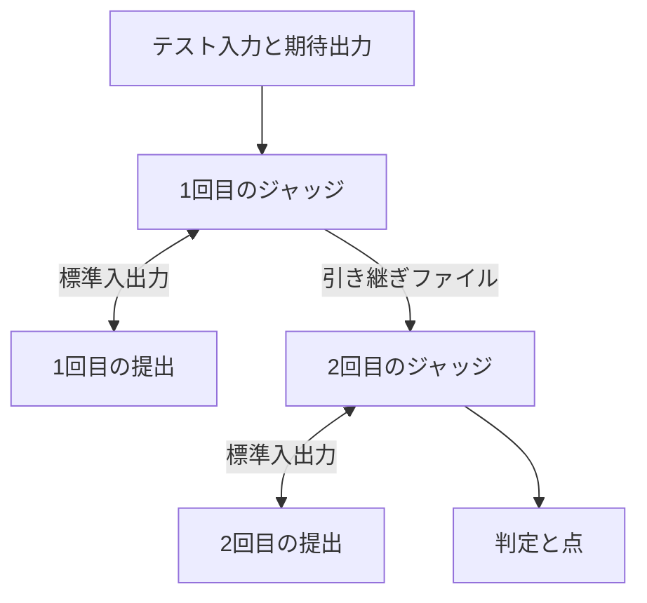

# 2ステップ形式（Run-twice）の設計

- 作成日: 2026-11-11
- 状態: 承認待ち
- 参考: [Run-twice problems with Polygon and testlib.h](https://codeforces.com/blog/entry/142052)、[DOJ #644 Magic Contest](https://doj.kr/ja/problems/644)

## 目的

提出プログラムを1ケースにつき2回実行し、1回目の結果を加工して2回目へ渡す問題を出せるようにする。
符号化と復号、圧縮と展開のように、2回目が1回目の入力を知っていると成立しない問題が対象になる。
2回の実行は別々の隔離環境で行うので、提出は作問者のプログラムを通してしか情報を持ち越せない。

DOJ #644では、1回目に二進文字列Sを受け取って符号を出力し、作問者側が1文字を挿入し、2回目にSを復元する。
得点は符号の長さで決まる。
この問題に相当するものをShareOJで作れることを、完成の目安とする。
メモリ制限はShareOJの上限（512 MiB）に合わせる。
得点は集計コード方式で付ける。

## 利用者と決めたこと

- 判定方法に「2ステップ形式（Run-twice）」を、通常、スペシャルジャッジ、対話形式と並ぶ4つ目の選択肢として加える。
  対話形式のスイッチにはしない。
- 作問者はプログラムを1本だけ書く。
  これを**2ステップ用ジャッジ**と呼ぶ。
  1回目と2回目の両方で提出の相手をし、1回目に書いた引き継ぎファイルを2回目に読む。
- 書き方は対話用ジャッジと同じにする。
  標準入力で提出の出力を読み、標準出力が提出の標準入力になる。
- 提出からは、どちらの回も標準入力を読んで標準出力へ書くだけに見える。
- 時間制限とメモリ制限は1回ごとに適用する。
- 提出結果に表示するCPU時間と最大メモリは、2回のうち大きいほうとする。
- 1回目で判定が確定したら、2回目を実行しない。
- 点は2回目のものだけを読む。
- 何回目かを提出へ伝える方法は、システムで決めない。
  作問者が問題文と2ステップ用ジャッジで決める（先頭行の`0`と`1`など）。
- 開発用Dockerワーカーは対応しない。

## やらないこと

- 3回以上の実行。
- 1回目の出力をそのまま2回目の標準入力にする、ジャッジを書かない簡易な方式。
- 2ステップ用ジャッジの後に別の検証コードを実行する方式。
  正誤と点は2ステップ用ジャッジ自身が決める。
- 2回の実行のあいだでの、提出側のファイルやメモリの持ち越し。
  これができると問題が成立しないので、誤って可能にしてはならない。

## 保存とAPI

以下は設計者の判断である。

下書きに`runTwice`を加える。
形は`checker`、`interactor`と同じ`{"runtime": "...", "source": "...", "protocol": "legacy" | "testlib"}`とする。
`checker`、`interactor`、`runTwice`は、同時に2つ以上を指定できない。
すべてなければ通常判定とする。

対話用ジャッジの規則を、名前を変えてそのまま適用する。

- 下書きでは空コードを保存できる。
  公開と提出には、空でないコードと公開中の言語が必要になる。
- 公開と提出の受付時に、2ステップ用ジャッジとテストケースを一緒に固定する。
- 公開準備の指摘に`run_twice_source_missing`と`run_twice_runtime_unavailable`を加える。
- 問題の公開APIはコードを返さず、`runTwice: true`だけを返す。
- 生成用と入力検証用のジョブには付けない。
- リジャッジ、サンプル検証（`easyTest`）、部分点（グループ方式と集計コード方式）は、対話形式と同じく使える。
- ローカルのDocker判定は、2ステップ形式の提出を受け付けない。
- DBマイグレーションは不要である。

ジョブにも`runTwice`を同じ形で載せる。
bridgeとワーカーは、`checker`、`interactor`、`runTwice`のうち2つ以上を持つジョブを拒否する。

## 1ケースの実行

提出と2ステップ用ジャッジは、それぞれ1回だけコンパイルする。
各回は、既存の対話形式の1ケースと同じ手順で実行する。
両方の隔離環境を作り、プログラムを同時に起動して標準入出力を中継し、終了後に作業領域と子孫プロセスを破棄する。
2回目の隔離環境は新しく作り、1回目の内容を残さない。
残すのは、管理ワーカーが読み取った引き継ぎファイルの内容だけである。

### 現行形式の引数

対話用ジャッジの4つの引数の後ろに、2つを足す。

1. テスト入力。
2. 期待出力。未使用なら空ファイル。
3. 提出されたソースコード。
4. 書き込み可能なスコアファイル。
5. 何回目か。`1`か`2`の文字列。
6. 引き継ぎファイル。

引き継ぎファイルは、1回目には空で書き込める。
2回目には1回目に書いた内容が入っていて、読み取り専用である。
テスト入力と期待出力は、2回とも同じものを渡す。

### testlib形式の引数

testlibの`registerInteraction`は引数を足せないので、Polygonと同じ受け渡しにする。
Polygon用に書かれたinteractorを、ほぼそのまま使えるようにするためである。

- 1回目の`inf`はテスト入力である。
  `tout`に書いた内容が引き継ぎになる。
- 2回目の`inf`は、1回目の`tout`の内容である。
  元のテスト入力は渡らない。
  2回目の`tout`は使わない。
- `ans`は2回とも期待出力である。
- 何回目かは引数で伝わらない。
  作問者はテスト入力の先頭に`0`を置き、`tout`の先頭に`1`を書くなどして見分ける。

### 引き継ぎファイル

- 上限は16 MiBとする。
  超えた場合と、通常のファイルでない場合は、提出全体をJEにする。
- 空でもよい。
- 1回目の両方のプログラムが止まってから読む。
  読むのは1回目がACのときだけとし、大きさもそのときにだけ確かめる。
- 提出の隔離環境には置かない。

## 判定

各回の判定は、[対話形式の終了と判定](../../judge/interactive-judge.md#終了と判定)の規則で決める。

- 1回目がAC以外なら、それをケースの判定とし、2回目を実行しない。
  JEなら、既存の規則どおり提出全体をJEにする。
- 1回目がACなら2回目を実行し、その判定をケースの判定とする。
- どちらの回でも、ACには提出の正常終了が必要である。

点は2回目だけを読む。
1回目のスコアファイルとtestlibの結果ファイルは読まない。
testlib形式の1回目が`quitp`で終えた場合は、集計コード方式の問題とそのサンプル検証でだけ、`_ok`と同じく通過として扱い、点を捨てる。
それ以外の問題では、既存の対話形式と同じくWAとし、診断に既存の注記を残す。

ケースの計測値は次のとおりとする。

| 項目 | 値 |
| --- | --- |
| CPU時間 | 2回のうち大きいほう |
| 最大メモリ | 2回のうち大きいほう |
| 経過時間 | 2回の合計 |

2回目を実行しなかったケースは、1回目の値を使う。

部分点のTLEによる打ち切りは、ケースの最終的な判定で数える。
どちらの回のTLEでも、ケースとして1回のTLEである。

## 資源上限

各回の上限は、対話形式の値をそのまま使う。

| 対象 | 上限 |
| --- | --- |
| 提出のCPU時間とメモリ | 問題設定の値。1回ごと |
| 2ステップ用ジャッジのCPU時間 | 1回ごとに5秒 |
| 2ステップ用ジャッジのメモリ | 256 MiB |
| 対話の経過時間 | 1回ごとに`3 × (提出のCPU上限秒 + 5) + 1`秒 |
| 各方向の標準出力 | 1回ごとに16 MiB |
| 引き継ぎファイル | 16 MiB |
| ソース | 提出128 KiB、2ステップ用ジャッジ64 KiB |
| 採点全体の経過時間 | 1,800秒。部分点の問題では1,500秒で残りを実行しない |

採点全体の上限は変えない。
1ケースが最長で2倍の時間を使うので、ケース数の多い問題は全体の上限に届きやすくなる。
この点を作問者向けドキュメントに書く。

同時に動くプログラムは対話形式と同じ2本なので、メモリとプロセス数の配分は変えない。
isolateのbox IDと専用UID/GIDも、対話形式の0と1を使い回す。

## 診断

対話形式と同じく`checkerLog`に入れ、同じ認可と保存量の上限を適用する。
各ケースの中で、`1回目:`と`2回目:`の見出しを付けて対話履歴とジャッジの標準エラーを分ける。
2回目を実行しなかった場合は、その理由が1回目の判定だと分かるようにする。
サンプル検証のケースごとの診断も、同じ見出しで分ける。

## Web

- 問題編集画面の判定方法に「2ステップ形式（Run-twice）」を加える。
  選ぶと、2ステップ用ジャッジの言語、形式（現行、testlib）、コードの入力欄が出る。
  判定方法を切り替えたときのコードの扱いは、既存の選択肢と同じにする。
- 入力欄の説明に、引数の一覧（何回目か、引き継ぎファイル）とflushの注意を載せる。
- 問題ページとコンテストの問題ページに「2ステップ形式（Run-twice）」と表示する。
  位置と見た目は対話形式の表示に合わせる。
- 提出フォーム、提出詳細、サンプル検証の結果は、対話形式と同じ扱いにする。
  たとえば、サンプルの入力と期待出力の対比は出さず、作問者には診断を出す。
- 公開準備の指摘に、2ステップ用ジャッジの空コードと使えない言語の文言を加える。
- 作問者向けドキュメントの[判定コードのページ](../../../web/app/content/docs/checkers.md)に節を加え、現行形式とtestlib形式の例を載せる。
  例はDOJ #644に近い「符号化して1文字挿入し、復元する」問題とする。

## CLI

`problem.toml`に、`[checker]`、`[interactor]`と並ぶ表として2ステップ用ジャッジを加える。
`pull`と`push`は対話用ジャッジと同じ規則で扱い、3つのうち1つだけを指定できる。
表の名前とファイル名は実装者が既存の命名に合わせて決める。
CLIのREADME、ガイド、Webのドキュメントを更新する。

## 配置

旧ワーカーは`runTwice`を解釈せず、通常判定として採点してしまう。
このため、配置は[ランタイムの再構築と公開](../../judge/runtime-rollout.md)に従う。

1. ワーカーを`judge/rollout.py run`で配布する。
   runtime digestが変わるので、新しいdigestをAPIとbridgeに設定する。
2. APIとbridgeを配置する。
3. Webを配置する。

`main`へのpushはAPIを自動で配置する。
ワーカーの配布が終わるまで、APIとbridgeの変更を`main`へpushしない。

実機のsmoke testに、2ステップ形式の検証を加える。
現行形式とtestlib形式の両方で、引き継ぎ、1回目の失敗による打ち切り、2回目の点を確認する。

## ドキュメント

- ADRを追加する（次の番号は0036）。
- `docs/judge/`に仕様を追加し、`docs/judge/README.md`から参照する。
- ShareOJの作問スキル（`shareoj-authoring`）に判定方法の一覧があれば、2ステップ形式を加える。

## 検証

- ワーカーの単体テスト：引き継ぎの受け渡し、1回目のWA、TLE、RE、JEでの打ち切り、2回目の点、計測値の集約、引き継ぎファイルの上限超過、testlib形式の`inf`の差し替え。
- 提出が1回目に書いたファイルを2回目に読めないことのテスト。
- APIとbridgeのテスト：3つの判定コードの排他、公開準備の指摘、公開APIがコードを返さないこと、作問者以外への診断の非公開。
- Webのテスト：判定方法の切り替え、問題ページの表示。
- 実機：DOJ #644相当の問題を作り、正解、長さ超過、復元の誤りを提出して判定と点を確かめる。

## 実装者に任せること

- `runTwice`以外の内部の名前、関数の分け方、`interactive.py`の再利用の仕方。
- 診断の見出しの細かな書式。
- CLIの表の名前とファイル名。
- Webの文言の細部。
